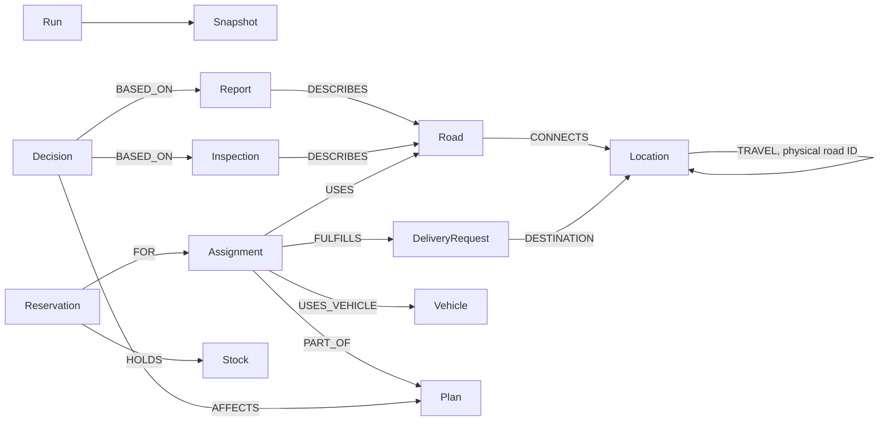

# Operational graph

Each run has its own graph named `lastmile_<validated 32-character UUID hex>`. The graph contains only observations and operational records. Seeds, physical road truth and future simulator schedules are excluded.

## Authority and IDs

The `Run.data` property stores typed scalar run metadata, revision and idempotency receipts. Each `Entity.data` stores one validated entity record. It is a JSON property **inside FalkorDB**, not an external state store. The `kind` field selects the public Pydantic entity type. Per-label query fields (`status`, `valid_until`, `state`) and `TRAVEL` edges are derived projections written in the same fixed graph mutation query as the authoritative records. No asynchronous graph sync exists.

Locations use `d1..d3`, `s1..s5`, `j1..j8`. Physical roads use `r01..r25` in both traversal directions. Stock nodes use `stock-d1..stock-d3`, avoiding ID collisions with their physical depot Location. The Stock payload's `id` identifies its depot. Requests use `q1..q6`; vehicles `v1..v4`. Plans have content IDs incorporating graph revision; assignments use generated IDs. Events have monotonically increasing `seq`; snapshots use the committed revision.

`Snapshot.data` is a complete historical observed world at one committed revision, used only for replay. It is not read by the planner and cannot be committed. `Event`, `Plan`, `Decision`, `Reservation` and `Inspection` are real graph nodes. Decision links identify exact source entities and plans. Event summaries and referenced IDs record invalidation and supersession; they are not executable instructions.

The scenario topology is immutable within a run. Road status and verification fields change through observations/expiry; endpoints and directionality do not. For a bidirectional physical road, its two `TRAVEL` relationships share one road ID and receive identical evidence fields in the same write. Initial unidirectional roads produce only one traversal relationship.

## Queries that do the work

| File | Used for |
| --- | --- |
| `queries/paths.cypher` | Real simple-path traversal, filtering blocked/unverified edges before ordering alternatives. |
| `queries/impact.cypher` | Report → road → active/blocked assignment → request. |
| `queries/bottlenecks.cypher` | Shared structural dependencies across outstanding requests. Counts reachability, not causal necessity of a road. |
| `queries/resources.cypher` | Vehicle, assignment, stock and reservation records. |
| `queries/decision.cypher` | Recorded decision → exact evidence and plan. |
| `queries/load.cypher`, `resume.cypher` | Reconstitute typed operational state from graph entities. |
| `queries/write.cypher` | One revision-guarded state/reservation/projection/snapshot transition. |
| `queries/replay.cypher` | Ordered immutable historical snapshots. |

The path query bounds simple paths to **12 hops** and returns the first **6 alternatives by travel cost and road IDs** for each pair. There are no repeated locations. A longer valid route is returned when a shorter road is closed. The planner separately checks each segment's verification at its predicted entry time. This is bounded coverage, not complete enumeration of every path in the town. The optimiser enumerates one- and two-stop delivery candidates from those query results.

Inspection hypotheses pass one road ID and assumed status as query parameters. They do not change the graph. Live state is read-only during ranking. There are no user/model-supplied executable Cypher strings. Graph names are validated before use. Indexes on Entity, Location, Road, DeliveryRequest and Decision IDs are created using syntax verified against FalkorDB 4.16.0.

The optional evidence view shows actual query names, non-secret parameters, returned IDs and measured wall durations. Its rolling diagnostic buffer is process-local; operational decisions/events are persisted separately. The `resources` query is provided for direct graph inspection; the planner uses the same authoritative records loaded by `load` to compute available stock as initial stock minus all non-released reservations.
